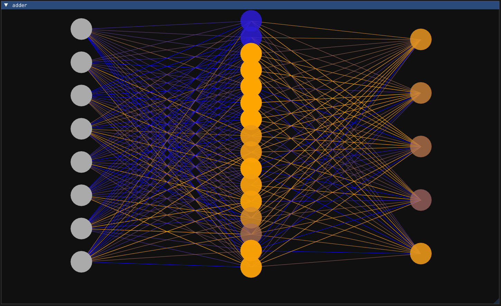
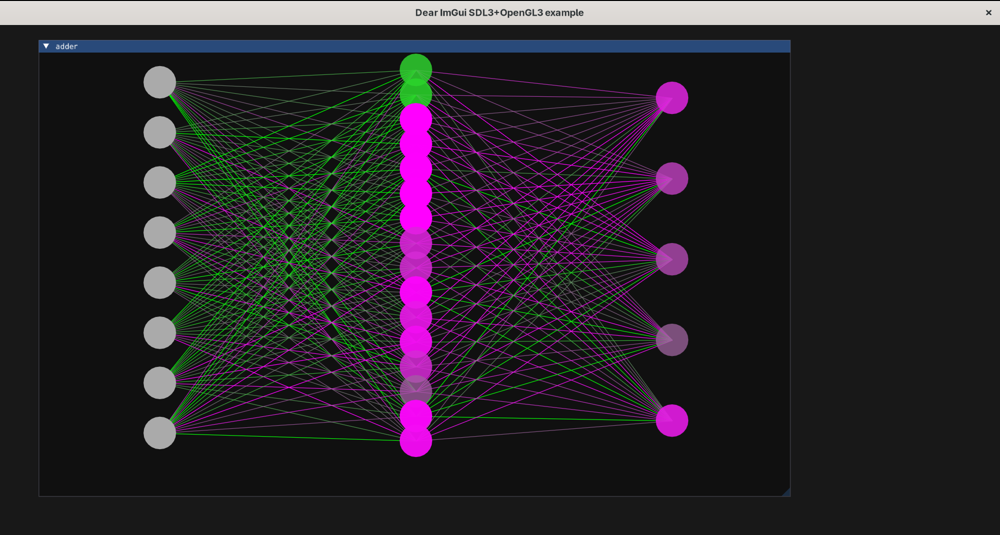

# About



This is a small project to learn machine learning and AI in general from scratch,
by building a custom Deep learning framework in C/C++ `nn.h`, and using it to develop a number
of small neural networks.

The aim was to learn hands on at a low-level how some concepts I would use in
high-level frameworks (e.g. pytorch) and python work practically, by implementing them.

This project was done by following [@tsoding](https://github.com/tsoding/nn.h) "Machine Learning in C" playlist in
YouTube, but a custom visualization of the neural network in Imgui was implemented.

# Setup

- Build the adder neural network specified in `adder.cpp`

```
$ ./build.sh
$ ./adder_imgui
```




# Ref

- [Tsoding Daily - Machine Learning in C](https://www.youtube.com/watch?v=PGSba51aRYU&list=PLpM-Dvs8t0VZPZKggcql-MmjaBdZKeDMw)
- https://github.com/tsoding/nn.h
